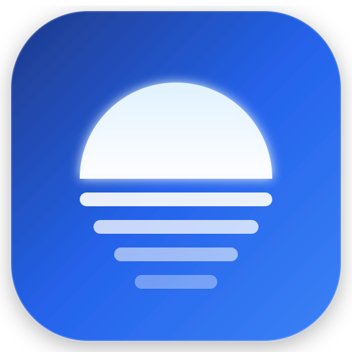

<div align="center">

<p align="center">
  
</p>

<h1 align="center">Silicon — WebView APK Template</h1>

[](https://github.com/fazle-rabbi-dev/Html-Css-Js-Web-View-Apk-Template/actions/workflows/build-apk.yml)
-3DDC84?logo=android&logoColor=white>)
   

<p align="center">
  <em>Turn any HTML/CSS/JS website into an installable Android app — no Kotlin, no Android SDK, no browser chrome.</em>
</p>

<p align="center">
  Drop your site into <code>app/</code> &middot; push to GitHub &middot; download an APK from Actions.
</p>

</div>

> **Origin story:** started in 2020 with the Android _APK Builder_ app — see the full story below. ⬇️

> [!IMPORTANT]
> 🚨 **APK tested on Android 12** — verified and working on Android 12 devices. Make sure **Play Protect is turned off** on the device before installing the APK.

> [!TIP]
> 🤖 **Ask the agent to build an app** — e.g. _"Build a todolist app with local storage"_ — and the agent takes the heavy lifting.

## Features

- 📦 **Zero dependencies** — pure Java, no AndroidX, no Kotlin, no Gradle plugins beyond AGP
- ☁️ **Cloud build** — push to GitHub, get an APK from Actions; nothing to install locally
- 📱 **Android 6+** (API 23) through Android 15 (API 35)
- 🌐 **Offline-first** — `localStorage`, DOM storage and relative asset paths all work
- 🔐 **Real `https` origin** — serves `app/` from `https://appassets.androidplatform.net/assets/`, not `file:///`, so the page is a secure context (mic, camera, geolocation, clipboard behave like a real site)
- 🌉 **Native bridge** — camera, mic, geolocation, file picker, share, clipboard, notifications, native storage, async callbacks
- 🎨 **Branded splash** — full-screen dot grid, theme-aware (light/dark), app icon as the mark
- 🔔 **Custom toast view** — app icon shows on ROMs that draw the stock robot
- 📥 **Downloads** — routed through `DownloadManager` with runtime permission handling

## 🏆 What I built with this template

A few apps shipped with this template as the base — each one is just an `app/` folder plus the native bridge:

|     | App                 | What it does                                                      |
| --- | ------------------- | ----------------------------------------------------------------- |
| 🕰️  | [Standby Clock](#)  | Always-on bedside clock with brightness control and ambient mode  |
| 🍅  | [Pomodoro Timer](#) | Focus timer with native notifications and vibration cues          |
| 📺  | [YT Summarizer](#)  | Paste a YouTube link, get an AI summary — offline-friendly UI     |
| 🎨  | [Paint App](#)      | Finger-painting canvas with save-to-gallery via the native bridge |

> Want your app featured here? Open a PR with a screenshot and a link.

## How it works

A tiny native shell (`MainActivity.java`) opens a full-screen `WebView` and loads

```java
webView.loadUrl("https://appassets.androidplatform.net/assets/index.html");
```

That URL doesn't exist on the internet. `WebViewClient.shouldInterceptRequest` catches every request to
`appassets.androidplatform.net` whose path starts with `/assets/`, strips the prefix, and streams the file
straight out of the APK's asset folder:

```
https://appassets.androidplatform.net/assets/index.html
                                   └────────┬────────┘
                                    assets/index.html  →  getAssets().open("index.html")
```

MIME type comes from `MimeTypeMap` (fallback `application/octet-stream`), so CSS, JS, fonts, JSON and images
load with the right content type. Anything not under `/assets/` on that host is ignored (returns `null`), and any
other host is left to the WebView as a normal network request.

This is the same trick as AndroidX's `WebViewAssetLoader` — done by hand to keep the **zero-dependency** promise.

**Why not `file:///android_asset/index.html` (the old way)?** Because `file://` is an opaque origin: the WebView
treats it as non-secure, so `getUserMedia`, geolocation and clipboard are unreliable or refused outright; `fetch()`
of local files gets blocked by CORS; and `localStorage` sits in a single opaque bucket instead of a real app
origin. A real `https` origin fixes all of that while the assets stay local and offline.

Your web code runs offline-capable inside the APK — same idea as a PWA, but as a real installable app with no
browser chrome & it's **lightweight 🚀**

> Current bundled app: **Silicon** (`starter template`) — a hands-on demo of every native bridge this template can wire up (camera, mic, geolocation, file picker, share, clipboard, notifications, storage, async callbacks) plus an honest list of what it can't.

## 📱 Get an APK (easiest — cloud build)

1. Fork / clone this repo.
2. Replace the files in `app/` with your own site (keep `index.html` as the entry point).
3. Push to GitHub → the **Build APK** workflow runs automatically.
4. Go to **Actions** → latest run → download the **Silicon** artifact.
5. Copy the APK to your phone and install.

No computer setup needed beyond `git push 🎉`.

## 🛠️ Build locally (optional) `Not recommended`

- **Android Studio:** open this folder, _Build > Build APK(s)_. (The Gradle files are generated by CI, so for a local build copy them from `.github/workflows/build-apk.yml`'s "Generate Gradle build files" step, or ask your agent to scaffold them.)
- **Legacy:** open the project in APK Builder / AIDE on-device via the `.project` file. Unmaintained on Android 12+; cloud build recommended.

## 📁 Project structure

```
app/            ← YOUR APP LIVES HERE (index.html entry point, served at
                  https://appassets.androidplatform.net/assets/)
src/com/fazlerabbi/silicon/MainActivity.java   ← WebView shell, asset intercept + native bridge
res/               ← icon, layout, strings
AndroidManifest.xml          ← permissions, launcher activity
.github/workflows/ ← cloud APK build
```

## 🌉 Native bridge (what Silicon proves)

The shell exposes a `Native` object to JS via `addJavascriptInterface`:

```js
Native.toastMsg("hi"); // void, fire and forget
Native.shareText("..."); // opens the system share sheet
Native.setValue("k", "v"); // SharedPreferences
const info = JSON.parse(Native.deviceInfo());
Native.ping("payload", "cb1"); // async, answered by window.Silicon.onNative
```

Native → JS callbacks go through `webView.evaluateJavascript(...)`. Camera/mic go through
`WebChromeClient.onPermissionRequest`, geolocation through `onGeolocationPermissionsShowPrompt`,
file input through `onShowFileChooser` — all with runtime permission handling.

No dependencies, no AndroidX. Open `app/index.html` in a browser and the banner says
`bridge: missing` — the native-only cards explain themselves.

## 📝 Notes

- `localStorage`, cookies and IndexedDB work (DOM storage is enabled) — great for offline-first apps. They are scoped to `https://appassets.androidplatform.net`, so data saved by an older `file://` build of your app will **not** carry over.
- `app/` is the whole web root, served at `https://appassets.androidplatform.net/assets/`. Keep `index.html` at the top of `app/` and use plain relative paths (`./style.css`, `./app.js`, `assets/…`) — they resolve under `/assets/`. Never write `file:///android_asset/` in your HTML.
- External CDNs (Tailwind, fonts, icons) need internet; the `INTERNET` permission is declared. Fully self-contained apps work 100% offline.
- Links the WebView itself navigates to (anything not handled by `Native.openUrl`) stay inside the app, since `shouldOverrideUrlLoading` returns `false`. Use `Native.openUrl(url)` when you want the system browser / a real app instead.
- Service Workers aren't part of this template. The origin is now `https` so registration is no longer impossible, but nothing here installs a `ServiceWorker` or serves SW headers — don't add `navigator.serviceWorker.register` unless you plan to test it. Plain relative asset paths are enough for offline.
- The CI patches the manifest to `targetSdk 34` + `android:exported` so the APK installs on Android 12+.
- Downloads to the public `Download/` folder need `WRITE_EXTERNAL_STORAGE` on Android 6–9 (handled automatically with a runtime permission prompt).

## 📖 Origin story

<details>
<summary><b>How this template came to be (click to expand)</b></summary>

<br>

Back in **2020**, I used an Android app called **APK Builder**. It shipped a handful of templates (flashlight, WebView, and a few others) — you picked one and it built an APK for you. I picked the **WebView** template, which by default just loaded `google.com`.

Then I watched a YouTube video about WebView APKs and spotted the magic link: `file:///android_asset/...`. The idea clicked — what if I replaced `google.com` with that link and dropped my own website into the `assets/` folder?

I tried it. **It worked.** I was so excited I could barely sit still.

In **2022** I took that same template, cleaned it up, modified a few things, and pushed it to GitHub as my base template.

Four years later, with the power of an **AI coding agent**, I've finally modernized it: Android 6+ support, a native bridge (camera, mic, geolocation, share, storage, async callbacks), a branded splash, a proper app icon, and a cloud build via GitHub Actions. The last upgrade was dropping `file:///android_asset/` in favour of a real `https://appassets.androidplatform.net` origin, intercepted and served from `assets/` — so the page finally behaves like a real site. What used to take weeks of trial and error now ships in days.

Thanks to AI for making it possible. 🙌

</details>

## 🤝 Contributing

Issues and pull requests are welcome. If you'd like to improve this template, open an issue or a PR.

## ⭐ Support

If this template helped you, consider giving it a star — it keeps the project alive.

<p align="center">
  <sub>Built with ❤️ for the web-devs-who-want-an-APK crowd.</sub>
</p>
