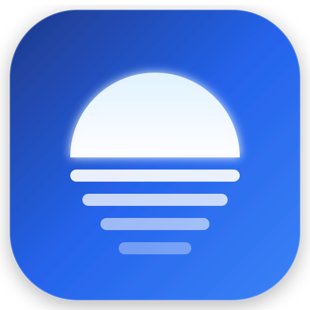

<div align="center">

<p align="center">
  
</p>

<h1 align="center">Silicon — WebView APK Template</h1>

[](https://github.com/fazle-rabbi-dev/Html-Css-Js-Web-View-Apk-Template/actions/workflows/build-apk.yml)
-3DDC84?logo=android&logoColor=white>)
   

<p align="center">
  <em>Turn any HTML/CSS/JS website into an installable Android app — no Kotlin, no Android SDK, no browser chrome.</em>
</p>

<p align="center">
  Drop your site into <code>app/</code> &middot; push to GitHub &middot; download an APK from Actions.
</p>

</div>

> **Origin story:** started in 2020 with the Android _APK Builder_ app — see the full story below. ⬇️

> [!IMPORTANT]
> 🚨 **APK tested on Android 12** — verified and working on Android 12 devices. Make sure **Play Protect is turned off** on the device before installing the APK.

> [!TIP]
> 🤖 **Ask the agent to build an app** — e.g. _"Build a todolist app with local storage"_ — and the agent takes the heavy lifting.

## Features

- 📦 **Zero dependencies** — pure Java, no AndroidX, no Kotlin, no Gradle plugins beyond AGP
- ☁️ **Cloud build** — push to GitHub, get an APK from Actions; nothing to install locally
- 📱 **Android 6+** (API 23) through Android 15 (API 35)
- 🌐 **Offline-first** — `localStorage`, DOM storage and relative asset paths all work
- 🔐 **Real `https` origin** — your page runs as a secure context (mic, camera, geolocation, clipboard work like a real site)
- 🌉 **Native bridge** — camera, mic, geolocation, file picker, share, clipboard, notifications, native storage, async callbacks
- 🎨 **Branded splash** — full-screen dot grid, theme-aware (light/dark), app icon as the mark
- 🔔 **Custom toast view** — app icon shows on ROMs that draw the stock robot
- 📥 **Downloads** — routed through `DownloadManager` with runtime permission handling

## 🏆 What I built with this template

A few apps shipped with this template as the base — each one is just an `app/` folder plus the native bridge:

|     | App                 | What it does                                                      |
| --- | ------------------- | ----------------------------------------------------------------- |
| 🕰️  | [Standby Clock](#)  | Always-on bedside clock with brightness control and ambient mode  |
| 🍅  | [Pomodoro Timer](#) | Focus timer with native notifications and vibration cues          |
| 📺  | [YT Summarizer](#)  | Paste a YouTube link, get an AI summary — offline-friendly UI     |
| 🎨  | [Paint App](#)      | Finger-painting canvas with save-to-gallery via the native bridge |

> Want your app featured here? Open a PR with a screenshot and a link.

## How it works (core idea)

A tiny native shell opens a full-screen `WebView` and loads

```
https://appassets.androidplatform.net/assets/index.html
```

That URL isn't on the internet — `shouldInterceptRequest` streams the file straight from the APK's `assets/` folder. So your page runs on a **real `https` origin** (secure context: mic, camera, geolocation, clipboard, `localStorage`), while everything stays offline and local. Same trick as AndroidX's `WebViewAssetLoader`, done by hand to keep the **zero-dependency** promise.

## 📁 Project structure

```
app/            ← YOUR APP LIVES HERE (index.html entry point)
src/.../MainActivity.java   ← WebView shell, asset intercept + native bridge
res/               ← icon, layout, strings
AndroidManifest.xml          ← permissions, launcher activity
.github/workflows/ ← cloud APK build
```

## 🌉 Native bridge (like Capacitor, but built-in)

The shell injects a `Native` object into JS — camera, mic, geolocation, file picker, share, clipboard, notifications, native storage, async callbacks. **No npm package, no dependency** — it's part of the template. (See `AGENTS.md` for the full API.)

## 📱 Get an APK (easiest — cloud build)

1. Fork / clone this repo.
2. Put your app in `app/` — keep `app/index.html` as the entry point. Plain HTML/CSS/JS works as-is; a built **Vite + React** app also works.
3. Push to GitHub → the **Build APK** workflow runs automatically.
4. Go to **Actions** → latest run → download the **Silicon** artifact.
5. Copy the APK to your phone and install.

### ✅ What you can put in `app/`

| Your app                         | What to do                                                                                                                                    |
| -------------------------------- | --------------------------------------------------------------------------------------------------------------------------------------------- |
| Plain HTML / CSS / JS            | Drop the files in `app/`. Entry point must be `app/index.html`.                                                                               |
| Vite + React (or any bundler)    | `npm run build`, then copy the **contents of `dist/`** into `app/`. Set `base: './'` in `vite.config.js` so `assets/...` paths stay relative. |
| React Router                     | Use `HashRouter`, **never** `BrowserRouter`.                                                                                                  |
| Vanilla JS routing (hand-rolled) | Use hash-based routing (`#/page`) for the same reason.                                                                                        |

**Why `HashRouter`?** There's no server behind the APK, so `BrowserRouter`'s real paths 404 on reload/deep-link. `HashRouter` keeps the route after `#`, so `index.html` always loads.

No computer setup needed beyond `git push 🎉`.

### 🚀 To create a new app follow this checklist

_the following instruction for human, not for ai_

- [ ] `/start-new-app command`: this will suggest app names and create a new `feat/app-name` branch
- [ ] `/update-context command`: this will update the app name and app purpose in the Readme and Agentsmd top area so agents knows about this app
- [ ] `/build-web-app`: this will help to create web app in `/app` dir
- [ ] `/build-apk`: this will modify app name, icons, pkg name etc metadata
- [ ] Get svg app icon from chatgpt or this agent - Turn the svg into xml for adaptive icon from this site: https://inloop.github.io/svg2android/
- [ ] When agent ask give `svg icon`, `xml` icon
- [ ] `/download-apk`: this will download latest artifact from github action (**apk file**) and place at `C:\Users\Hp\Downloads\MEmu Download\`
- [ ] if u want to update status bar, run this command: `/update-status-bar` and follow up

## 🛠️ Build locally (optional) `Not recommended`

- **Legacy:** open the project in APK Builder / AIDE on-device via the `.project` file. Unmaintained on Android 12+; cloud build recommended.

## 📖 Origin story

<details>
<summary><b>How this template came to be (click to expand)</b></summary>

<br>

Back in **2020**, I used an Android app called **APK Builder**. It shipped a handful of templates (flashlight, WebView, and a few others) — you picked one and it built an APK for you. I picked the **WebView** template, which by default just loaded `google.com`.

Then I watched a YouTube video about WebView APKs and spotted the magic link: `file:///android_asset/...`. The idea clicked — what if I replaced `google.com` with that link and dropped my own website into the `assets/` folder?

I tried it. **It worked.** I was so excited I could barely sit still.

In **2022** I took that same template, cleaned it up, modified a few things, and pushed it to GitHub as my base template.

Four years later, with the power of an **AI coding agent**, I've finally modernized it: Android 6+ support, a native bridge (camera, mic, geolocation, share, storage, async callbacks), a branded splash, a proper app icon, and a cloud build via GitHub Actions. The last upgrade was dropping `file:///android_asset/` in favour of a real `https://appassets.androidplatform.net` origin, intercepted and served from `assets/` — so the page finally behaves like a real site. What used to take weeks of trial and error now ships in days.

Thanks to AI for making it possible. 🙌

</details>

## 🤝 Contributing

Issues and pull requests are welcome. If you'd like to improve this template, open an issue or a PR.

## ⭐ Support

If this template helped you, consider giving it a star — it keeps the project alive.

<p align="center">
  <sub>Built with ❤️ for the web-devs-who-want-an-APK crowd.</sub>
</p>

> Technical details for agents/contributors live in [`AGENTS.md`](./AGENTS.md).
